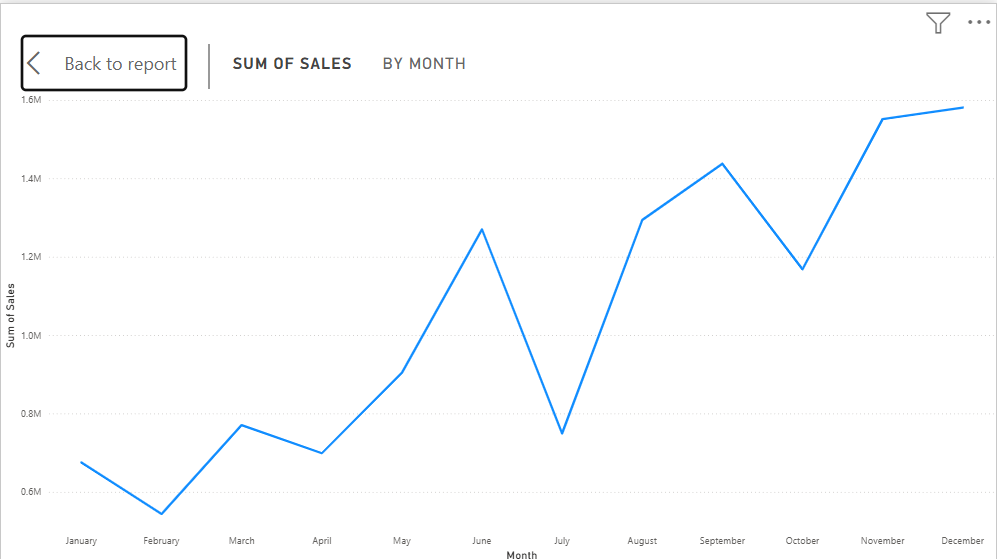
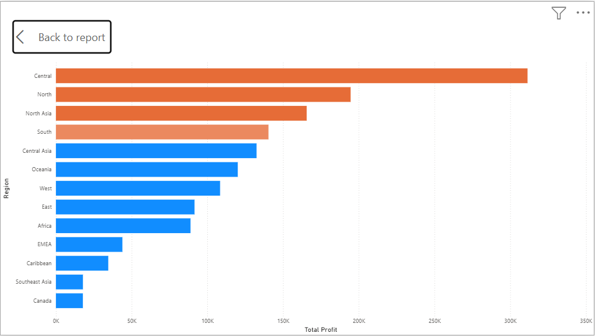
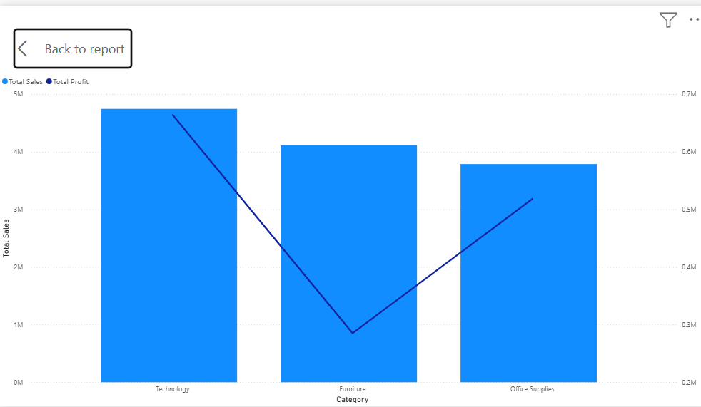
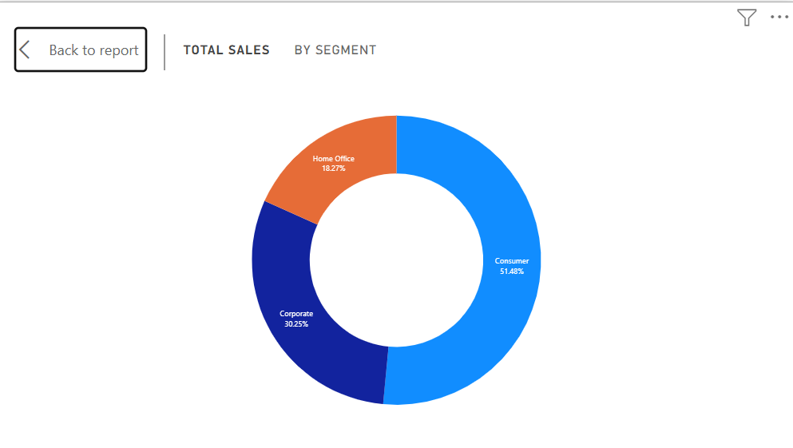
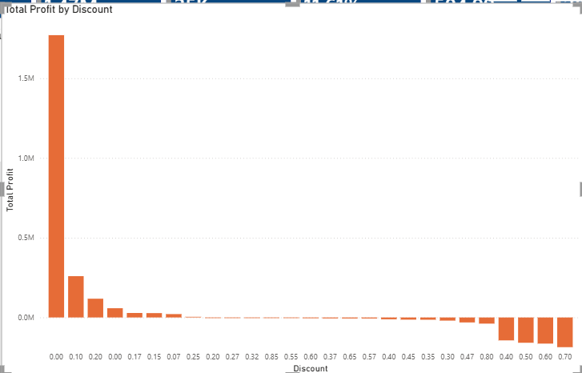

# Retail Sales and Profitability Analysis

An end-to-end retail analytics project using Python, Pandas, Power BI and DAX to investigate sales performance, profitability, product categories, customer segments and regional performance.

## Project Overview

This project analyses 51,290 retail transaction records covering 2011–2014. It combines Python-based data preparation and exploratory analysis with an interactive Power BI dashboard.

The objective is to turn raw retail transaction data into meaningful business insights that support pricing, sales and profitability decisions.

## Business Performance Overview

| Key Performance Indicator | Result |
|---|---:|
| Total Sales | 12,642,501.91 |
| Total Profit | 1,467,457.29 |
| Profit Margin | 11.61% |
| Total Orders | 25,035 |
| Total Customers | 1,590 |
| Average Order Value | 504.99 |

## Power BI Dashboard

The interactive dashboard provides an overview of retail performance, with filters for year, region, category and customer segment.

### Dashboard Visuals

**Monthly Sales Trend**



**Profit by Region**



**Sales and Profit by Category**



**Sales by Customer Segment**



**Profit by Discount**



## Analytical Visualisations

Additional Python-generated visualisations are available in `reports/figures/`.

| Analysis | Visualisation |
|---|---|
| Category Performance | `01_category_performance.png` |
| Regional Profitability | `02_regional_profitability.png` |
| Monthly Sales Trend | `03_monthly_sales_trend.png` |
| Monthly Profit Trend | `04_monthly_profit_trend.png` |
| Discount Profitability | `05_discount_profitability.png` |
| Subcategory Performance | `06_subcategory_performance.png` |
| Customer Segment Performance | `07_customer_segment_performance.png` |
| Shipping Performance | `08_shipping_performance.png` |

## Key Business Findings

**1. Category Performance**

Technology generated the highest profit at 663,778.73. Furniture recorded the lowest category profit margin at 6.94%.

**2. Regional Profitability**

Central generated the highest sales and profit. Southeast Asia recorded a profit margin of just 2.02%.

**3. Discount Analysis**

Higher discount levels were associated with weaker profitability. Several high-discount groups recorded negative profits.

**4. Product Performance**

The Tables subcategory recorded an overall loss of 64,083.39, making it an important area for further investigation.

**5. Sales Growth**

Annual sales increased from 2.26 million in 2011 to 4.30 million in 2014.

## Technical Workflow

1. Dataset inspection and structural assessment.
2. Data cleaning and validation using Python.
3. Exploratory data analysis using Pandas.
4. Statistical summaries and business performance analysis.
5. Data visualisation using Matplotlib and Seaborn.
6. Interactive dashboard development using Power BI and DAX.
7. Business findings and recommendations.

## Tools and Technologies

- Python
- Pandas
- Matplotlib
- Seaborn
- Power BI Desktop
- DAX
- Microsoft Excel
- Git and GitHub

## Repository Structure

```text
retail-sales-profitability-analysis/
│
├── dashboard/
│   └── retail_sales_profitability.pbix
│
├── images/
│   ├── 01_monthly_sales_trend.png
│   ├── 02_profit_by_region.png
│   ├── 03_sales_and_profit_by_category.png
│   ├── 04_sales_by_segment.png
│   └── 05_profit_by_discount.png
│
├── notebooks/
│   ├── 01_dataset_inspection.py
│   ├── 02_data_cleaning.py
│   ├── 03_exploratory_data_analysis.py
│   └── 04_data_visualizations.py
│
├── reports/
│   ├── eda/
│   ├── figures/
│   └── retail_sales_business_report.md
│
├── data/
├── sql/
├── .gitignore
└── README.md
```

## Business Recommendations

- Review high-discount transactions and their profitability.
- Investigate loss-making products and subcategories.
- Monitor regional profit margins.
- Evaluate product category performance when making pricing decisions.
- Use regular sales and profitability reporting to support business decisions.

## Limitations

- The analysis identifies associations and does not establish causation.
- The dataset does not explain the underlying reasons for every loss-making transaction.
- Currency denomination has not been independently established.
- Original dataset redistribution permissions should be checked before redistribution.

## Project Deliverables

- Python data inspection and cleaning scripts.
- Exploratory data analysis outputs.
- Eight analytical visualisations.
- Interactive Power BI dashboard.
- Business performance report.

## Author

**Austine Wizard**

Data Analytics | Business Intelligence | Python | Power BI

[GitHub Repository](https://github.com/AustineWizard/retail-sales-profitability-analysis)
