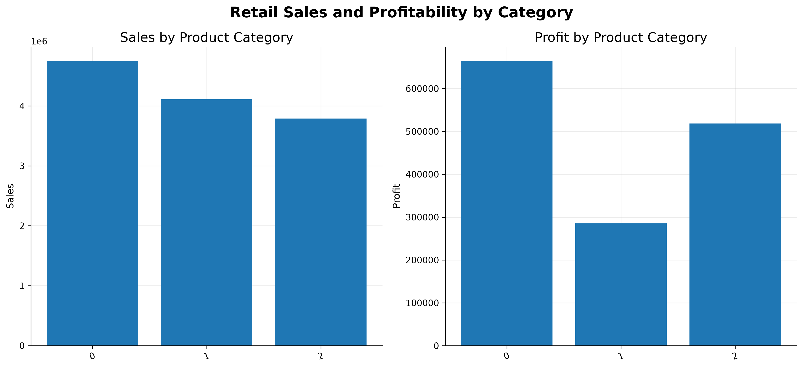
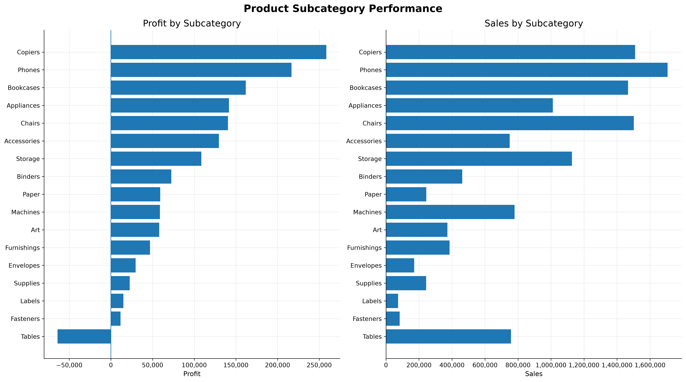
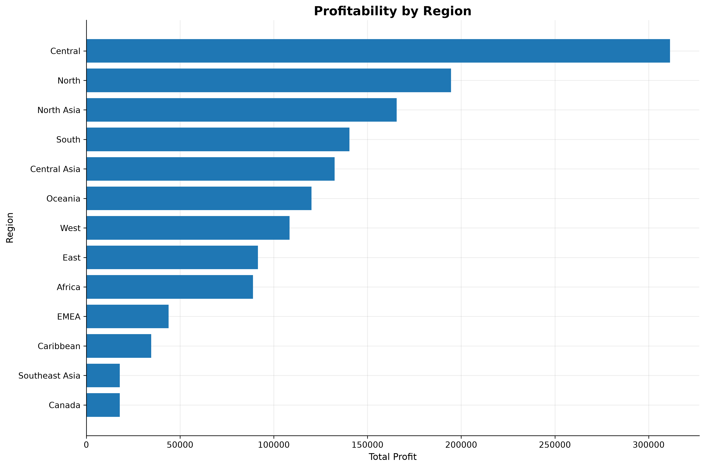
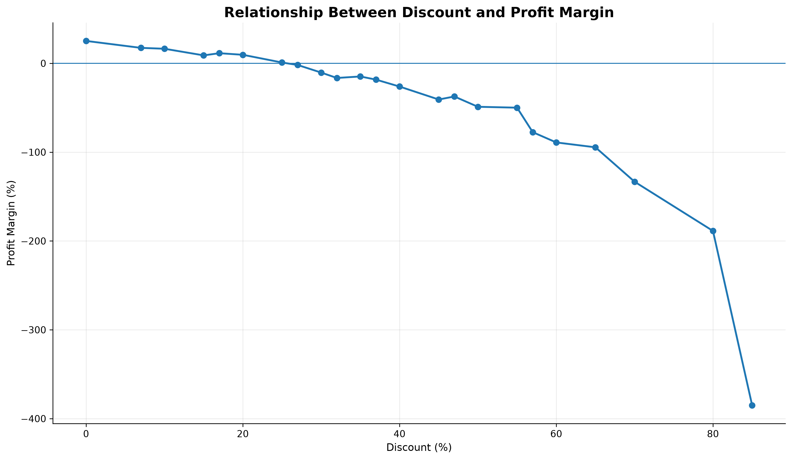
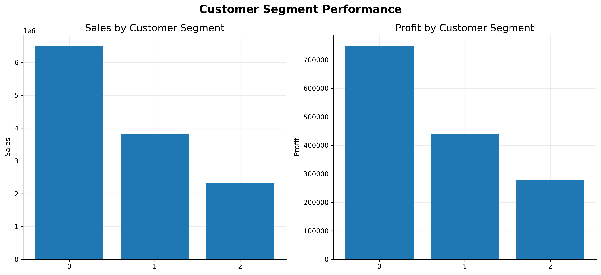
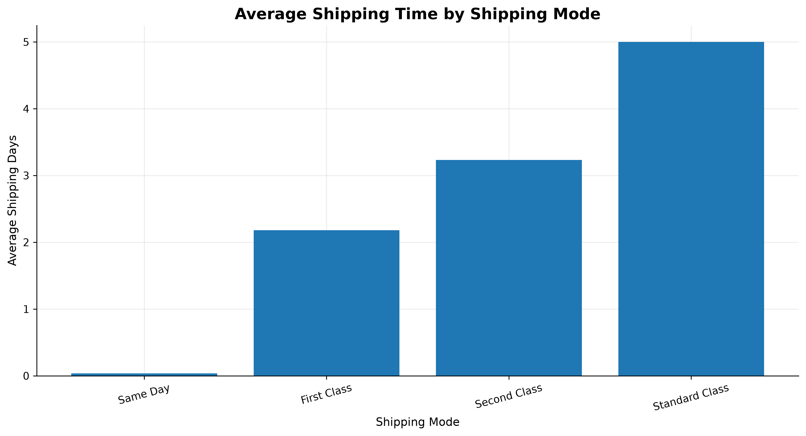
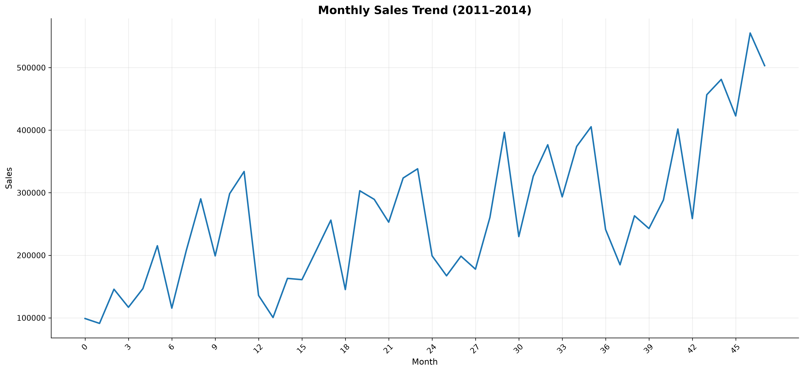
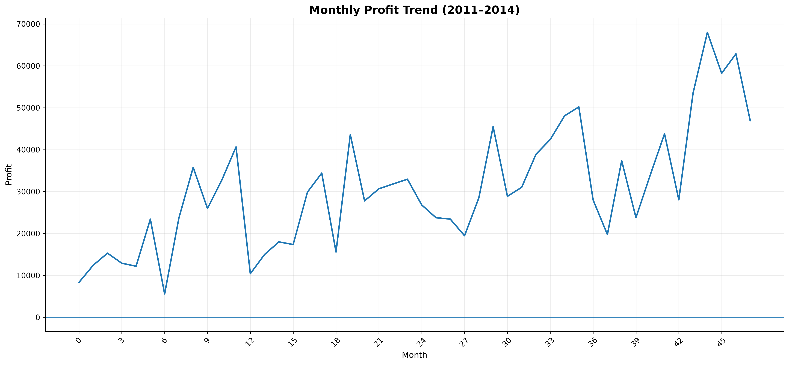

# Retail Sales and Profitability Analysis

## 1. Executive Summary

This project analyses 51,290 retail sales records from 2011 to 2014 to evaluate business performance, identify profitability challenges and provide data-driven recommendations.

The analysis covers sales trends, product performance, regional profitability, customer segments, discount patterns and shipping operations.

### Key Business Metrics

- **Total Sales:** 12,642,501.91
- **Total Profit:** 1,467,457.29
- **Profit Margin:** 11.61%
- **Total Orders:** 25,035
- **Unique Customers:** 1,590
- **Average Order Value:** 504.99

The business experienced consistent sales and profit growth throughout the four-year period. However, product losses, regional profitability differences and high discount levels present opportunities for improvement.

## 2. Sales and Product Performance

Technology was the strongest product category, generating 4,744,557.50 in sales and 663,778.73 in profit, with a profit margin of 13.99%.

Furniture generated 4,110,874.19 in sales but achieved a lower profit margin of 6.94%.

At the subcategory level, Copiers generated the highest profit at 258,567.55, while Tables recorded a loss of 64,083.39.

**Key Findings**
- Technology leads in both sales and total profit.
- Furniture has the weakest category profit margin.
- Copiers and Phones are major profit contributors.
- Tables is the only subcategory with negative overall profit.

**Business Recommendations**
- Review pricing and operating costs for Furniture.
- Investigate the losses recorded in Tables.
- Prioritize profitable product categories and subcategories.
- Monitor product performance using both sales and profit margins.

## 3. Regional Performance

Central was the strongest region by total sales and profit, generating 2,822,302.52 in sales and 311,403.98 in profit.

However, regional profit margins varied considerably.

- **North Asia:** Highest margin among the major regions at 19.52%.
- **North:** Profit margin of 15.59%.
- **Central:** Highest total profit at 311,403.98.
- **EMEA:** Low profit margin of 5.45%.
- **Southeast Asia:** Lowest profit margin at 2.02%.

Canada recorded a 26.62% profit margin, although its sales volume was comparatively low.

**Business Finding:** Strong sales volume does not always translate into strong regional profitability.

**Recommendation:** Investigate regional product mix, discounting, pricing and operating costs, particularly in Southeast Asia and EMEA.

## 4. Discount and Profitability Analysis

The analysis revealed a negative association between higher discount levels and profitability.

Transactions with no discount generated a profit margin of 25.21%. At a 20% discount, the margin declined to 9.60%.

Several higher discount groups recorded negative profits. For example:

- **30% Discount:** Profit of -19,685.85.
- **40% Discount:** Profit of -155,178.90.
- **50% Discount:** Profit of -158,629.88.
- **70% Discount:** Profit of -186,350.48.

**Business Finding:** Higher discount levels are associated with significant profitability challenges.

**Recommendation:**
- Review discount approval policies.
- Introduce minimum profit margin requirements.
- Identify products frequently sold at high discounts.
- Evaluate discount performance by product and region.

The observed relationship does not establish that discounts alone caused the losses.

## 5. Customer and Shipping Performance

### Customer Segments

Consumer customers generated the highest sales and profit.

- **Consumer:** Sales of 6,507,949.42 and profit of 749,239.78.
- **Corporate:** Sales of 3,824,697.52 and profit of 441,208.33.
- **Home Office:** Sales of 2,309,854.97 and profit of 277,009.18.

Home Office recorded the highest profit margin at 11.99%, compared with 11.51% for Consumer and 11.54% for Corporate.

**Recommendation:** Maintain Consumer customer retention while exploring opportunities to expand the Home Office segment.

### Shipping Performance

Standard Class generated the highest sales and profit, accounting for 7,578,652.11 in sales and 890,596.02 in profit.

Average shipping times were:

- **Same Day:** 0.04 days.
- **First Class:** 2.18 days.
- **Second Class:** 3.23 days.
- **Standard Class:** 5.00 days.

**Recommendation:** Evaluate shipping costs, delivery performance and customer requirements to identify opportunities for operational efficiency.

## 6. Sales Trends and Business Growth

Annual sales and profit increased consistently between 2011 and 2014.

- **2011:** Sales of 2,259,450.90.
- **2012:** Sales of 2,677,438.69.
- **2013:** Sales of 3,405,746.45.
- **2014:** Sales of 4,299,865.87.

Profit margin remained relatively stable between 11% and 12% throughout the period.

November 2014 recorded the highest monthly sales at 555,279.03.

**Business Finding:** The business achieved sustained sales growth without a comparable increase in overall profit margin.

**Recommendation:** Monitor monthly performance and investigate opportunities to improve profitability as sales expand.

## 7. Overall Business Recommendations

Based on the analysis, the following actions are recommended:

1. **Improve Product Profitability:** Investigate loss-making products and review product pricing and costs.
2. **Strengthen Discount Controls:** Introduce margin-based discount approvals to reduce unprofitable sales.
3. **Improve Regional Performance:** Investigate low-margin regions, particularly Southeast Asia and EMEA.
4. **Grow Customer Segments:** Develop strategies to increase Home Office sales while retaining Consumer customers.
5. **Optimize Shipping:** Review delivery costs and service performance across shipping methods.
6. **Monitor Business Performance:** Use interactive dashboards and regular reporting to track sales, profit and profitability trends.

## 8. Conclusion

The analysis demonstrates that the business achieved consistent sales and profit growth between 2011 and 2014. Technology, Central region and Consumer customers were major contributors to overall business performance.

However, product losses, regional margin differences and high discount levels highlight areas requiring management attention.

The findings demonstrate how Python-based data analysis and visualization can support business performance monitoring and informed decision-making.

## Tools and Technologies

Python | Pandas | Matplotlib | Microsoft Excel | Exploratory Data Analysis | Data Cleaning | Statistical Analysis | Business Reporting

## Project Limitations

The analysis covers historical records from 2011 to 2014. The findings describe the available dataset and should not be treated as current market performance.

The dataset does not establish the underlying causes of losses or regional profitability differences. Further investigation using operational costs, product costs and pricing information would be required.

All financial figures are presented in the dataset's reported units. No currency has been assumed.